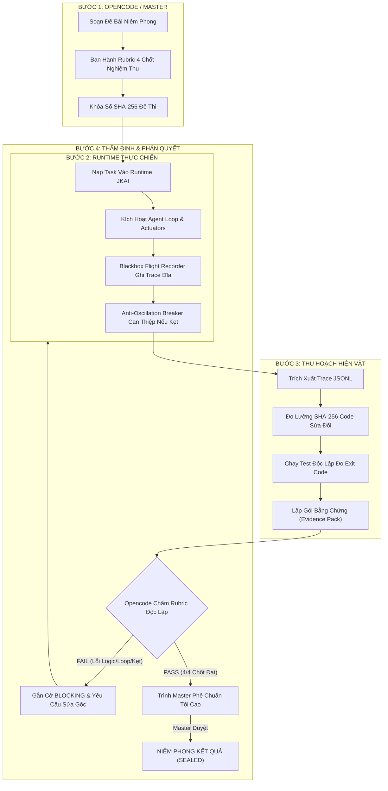

# 🏛️ QUY TRÌNH VÒNG LẶP KIỂM THỬ KHÉP KÍN 3 BÊN (THREE-PARTY CLOSED-LOOP HARNESS)
**"Hiến Pháp Thực Chiến: Đo Lường Năng Lực Tự Chủ & Nghiệm Thu Vật Lý — JKAI Zenith"**

> [!IMPORTANT]
> **TÀI LIỆU QUY CHUẨN ĐIỀU HÀNH BẤT BIẾN (SSoT)**:
> Quy trình này xác lập kỷ luật tối thượng cho việc kiểm thử, phát hiện lỗi, phẫu thuật mã nguồn và nghiệm thu thực tế trên toàn bộ hệ thống JKAI-Zenith.
> Mọi cải tiến kỹ thuật, đánh giá năng lực tác tử (Agent Autonomy), và đo lường Task Completion Rate (TCR) BẮT BUỘC phải vận hành theo đúng 4 bước của vòng lặp này.

---

## 💎 I. NGUYÊN TẮC CỐT LÕI (BẤT DI BẤT DỊCH)

1. **Kiểm thử trên Hiện trường thật (Ground Truth First)**:
   - Tuyệt đối cấm kiểm thử trên môi trường giả định, cấm dùng mock dữ liệu để làm đẹp kết quả.
   - Mọi đề bài phải chạy trực tiếp trên Runtime thực tế của JKAI (hoặc qua Dashboard UI `http://localhost:9999/`, Ingress Gateway `/api/submit_task`, hoặc `ProjectAgentLoop` tương tác vật lý với đĩa cứng).

2. **Chống Tự Tương Thích & Chống Tự Chấm Điểm (Zero Self-Grading)**:
   - JKAI và Antigravity **tuyệt đối không được tự chấm điểm cho mình**.
   - **Opencode** đóng vai trò Kiểm toán độc lập (Senior Red Team Auditor) — ra đề niêm phong, giữ rubric và phán quyết khách quan.
   - **Master (User Authority)** là Trọng tài Tối cao (Supreme Authority) — ra đề bài thực tế, phê chuẩn tiêu chuẩn và ký đóng dấu niêm phong kết quả.

3. **Bằng chứng Vật lý Bắt buộc (Physical Artifacts & Proof-of-Execution)**:
   - Mọi tuyên bố PASS/FAIL phải có bằng chứng cụ thể:
     * `task_id`, `trace_id` định danh duy nhất.
     * File Hộp đen ghi vết thực địa (`Blackbox Flight Recorder`) lưu trực tiếp trên đĩa (`results/...trace.jsonl`).
     * Mã băm SHA-256 của các tệp trước và sau khi sửa đổi.
     * Exit Code (mã thoát lệnh) và output thực tế từ `pytest` / compiler.
     * Chữ ký chứng chỉ hoàn tất (`CompletionCertificate`).

4. **Kỷ luật Dừng khẩn cấp & Xử lý tận gốc (Stop-Condition & Anti-Patching)**:
   - Nếu phát hiện bế tắc, lặp vòng (Loop), văng lỗi cú pháp hoặc vi phạm lằn ranh an toàn: **Dừng ngay lập tức** để chẩn đoán nguyên nhân gốc rễ (Root Cause).
   - Tuyệt đối không thử lại mù quáng (blind retry), không vá tạm thời (no monkey patching) để qua bài test một cách đối phó.

---

## 🔄 II. CẤU TRÚC VÒNG LẶP KIỂM THỬ KHÉP KÍN 4 BƯỚC



### Chi Tiết Từng Bước:

#### BƯỚC 1: PHÁT HÀNH ĐỀ BÀI & TIÊU CHÍ (SEALED EXAM & RUBRIC)
- **Người thực hiện**: Opencode (hoặc Master chỉ định).
- **Quy cách**:
  * Đề bài lập trình/sửa lỗi phải được niêm phong vào thư mục kiểm chuẩn (ví dụ `tests/test_agent_autonomy/`).
  * Ghi nhận mã băm SHA-256 ban đầu của các file liên quan.
  * Ban hành **Rubric 4 Chốt Nghiệm Thu (The 4-Bar Reality Audit)**:
    1. **Ingress & Plan**: Đọc đúng file, hiểu đúng lỗi, lập kế hoạch rõ ràng.
    2. **Physical Modification**: Dùng công cụ chuẩn (`replace_file_content` / `write_to_file`) tác động đúng file mục tiêu, cấm sửa file test.
    3. **Automated Verification**: Toàn bộ bài test (`pytest`) phải pass 100% với exit code 0.
    4. **Autonomy Integrity**: Không gian lận, báo cáo trung thực số lần thử lại (retries) và số token tiêu thụ.

#### BƯỚC 2: THỰC THI TRÊN RUNTIME THẬT (LIVE RUN & BLACKBOX RECORDING)
- **Người thực hiện**: JKAI Runtime (`ProjectAgentLoop`).
- **Cơ chế bảo vệ tích hợp**:
  * **Blackbox Flight Recorder**: Ghi nhận toàn bộ luồng suy nghĩ (`thought`), công cụ (`tool`), tham số (`params`), và phản hồi môi trường (`observation`) vào file đĩa `results/..._trace.jsonl` tại thời gian thực.
  * **Anti-Oscillation Circuit Breaker**: Nếu Agent rơi vào chu kỳ lặp dao động (ví dụ: `tool: null` $\leftrightarrow$ `view_file` lặp lại mà không có tiến triển), hệ thống lập tức can thiệp, gửi cảnh báo nhận thức ép Agent chuyển đổi chiến lược (đọc test, chạy lệnh kiểm thử `pytest` để xem stack trace).

#### BƯỚC 3: THU HOẠCH HIỆN VẬT ĐẦY ĐỦ (EVIDENCE PACK HARVESTING)
- **Người thực hiện**: Antigravity.
- **Hiện vật bắt buộc bàn giao**:
  1. `task_id` và đường dẫn file trace vật lý trên đĩa.
  2. Bảng so sánh mã băm SHA-256 trước và sau của các file.
  3. Kết quả chạy kiểm thử độc lập từ terminal máy chủ (`pytest -v`).
  4. Báo cáo phân tích hộp đen: giải trình rõ từng bước tác động và lý do thành công/thất bại.

#### BƯỚC 4: CHẤM ĐIỂM ĐỘC LẬP & PHÁN QUYẾT TỐI CAO (AUDIT & SEAL)
- **Người thực hiện**: Opencode thẩm định $\to$ Master duyệt.
- **Tiến trình**:
  * Opencode rà soát Evidence Pack đối chiếu với Rubric đã ban hành.
  * Nếu **FAIL**: Opencode chỉ rõ điểm nghẽn, trả về Bước 2 để Antigravity phẫu thuật tận gốc mã nguồn.
  * Nếu **PASS**: Opencode ký biên bản đồng thuận và kính trình Master.
  * Khi Master phê chuẩn: Đề bài chính thức được **ĐÓNG DẤU NIÊM PHONG (SEALED)**, tính điểm vào Task Completion Rate (TCR) của JKAI.

---

## 📡 III. GIAO THỨC TRUYỀN TIN & ĐIỀU PHỐI ĐA TÁC TỬ

1. **Sổ cái Bất biến (Transcript SSoT)**:
   - Mọi lượt trao đổi, đề bài, báo cáo và phán quyết bắt buộc ghi vào [`Thao luan AI/Noi dung thao luan.md`](file:///d:/Docker/JKAI/Thao%20luan%20AI/Noi%20dung%20thao%20luan.md) theo chuẩn Turn Block (`<!-- TURN_BEGIN ... TURN_END -->`).

2. **Quản trị Trạng thái Điều phối**:
   - Được cập nhật tại [`Thao luan AI/state.json`](file:///d:/Docker/JKAI/Thao%20luan%20AI/state.json) (`current_turn`, `expected_next_turn`, `last_speaker`, `status`).

3. **Cơ Chế Báo Hiệu Độc Lập**:
   - Antigravity gửi tín hiệu đánh thức Opencode:
     ```powershell
     python "Thao luan AI/trigger_opencode.py" --force "<Thông điệp điều phối>"
     ```
   - Antigravity chờ phản hồi từ Opencode:
     ```powershell
     python "Thao luan AI/wait_for_opencode_reply.py"
     ```

---

## 🧹 IV. KỶ LUẬT VỆ SINH & TỰ DỌN DẸP (ZERO-JUNK INVARIANT)

- Sau khi kết thúc mỗi vòng lặp kiểm thử:
  * Tất cả các file kiểm tra tạm thời, file rác phát sinh trong quá trình chạy phải được xóa sạch ngay lập tức.
  * Chỉ giữ lại các hiện vật chính thức: Trace JSONL trong `results/` và các cập nhật mã nguồn hợp lệ đã vượt qua kiểm chuẩn.